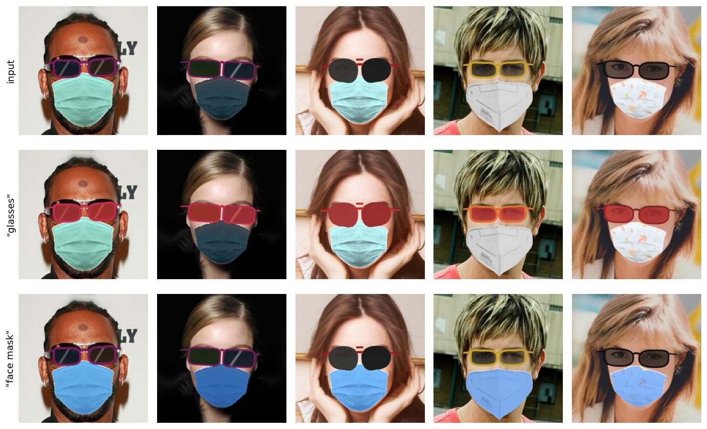
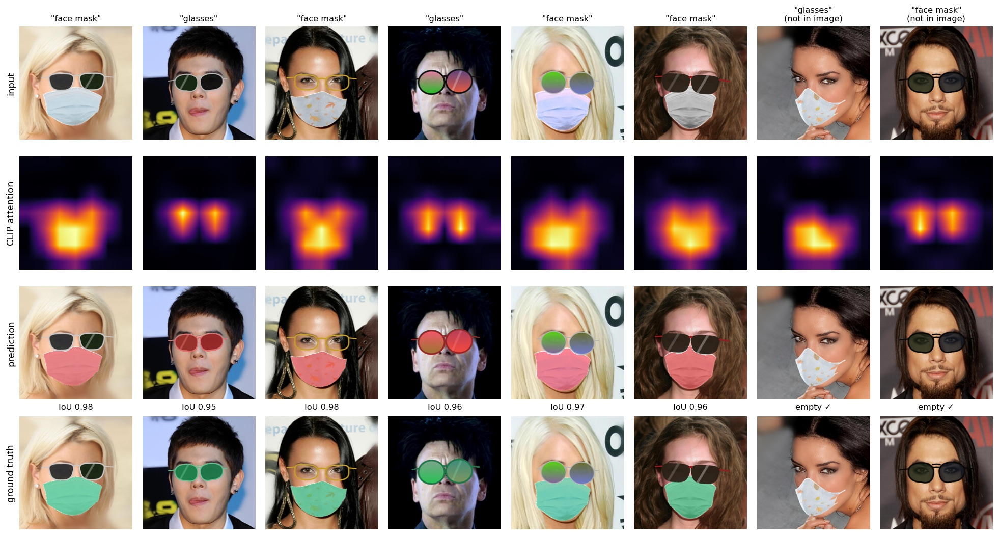
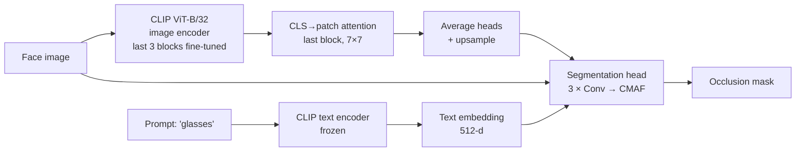

# Visus

**Segment what a face is wearing, by name.** Give Visus a face image and a prompt such as `"glasses"` or `"face mask"`, and it returns a pixel mask of the region that object covers. Ask for glasses on a face that only wears a mask, and it returns an empty mask.

[](https://github.com/SreenityaThatikunta/Visus/actions/workflows/ci.yml)


[](LICENSE)
[](docs/report/report.pdf)


<sub>Held-out test faces wearing both occluders. Row 2: prompt "glasses"; row 3: prompt "face mask". These masks use textures the model never saw in training.</sub>

## Highlights

- **CLIP as a spatial prior.** The CLS-to-patch attention of CLIP's last vision block tells the model roughly where the object is. A small head (about 0.7 M parameters) refines it with **Cross-Modal Attention Fusion**, conditioned on the CLIP text embedding of the prompt.
- **0.965 occlusion IoU** on held-out test faces (0.952 glasses, 0.979 face masks). When asked for the occluder that is absent, it returns an empty mask **99.7%** of the time.
- **A dataset with exact labels**: 29,668 CelebA-HQ faces with landmark-aligned face masks and procedurally drawn glasses. The labels come from the compositing step itself, and five mask textures are held out for testing.
- **An evaluation that can't be gamed.** Every number sits next to a predict-nothing baseline, and checkpoints are selected by √(IoU × clean rate), which is 0 both for empty predictions and for ignoring the prompt.
- **Ablations that justify the design**, plus per-category, prompt-robustness and failure analyses.
- **Reproducible on free GPUs.** Dataset generation, training, ablations and figures run as Kaggle jobs from the CLI ([`kaggle/push.sh`](kaggle/push.sh)), with tests and CI on every push.

## Results

Held-out synthetic test split: 2,969 faces, each queried with both prompts (3,542 pairs where the object is present, 2,388 where it is absent). The threshold (0.6) and the checkpoint (epoch 18 of 20) were chosen on validation.

| Model | IoU glasses | IoU face mask | IoU | Clean rate | Score |
|---|---|---|---|---|---|
| Empty-mask baseline | 0.000 | 0.000 | 0.000 | 1.000 | 0.000 |
| v1 (`visus_epoch50.pt`) | 0.357 | 0.467 | 0.412 | 0.001 | 0.019 |
| **Visus v2** | **0.952** | **0.979** | **0.965** | **0.997** | **0.981** |

*IoU*: overlap of the predicted and true occluded region, on pairs where the object is present. *Clean rate*: share of empty predictions on pairs where it is absent (e.g. "glasses" on a mask-only face). *Score*: √(IoU × clean rate).

### Ablations

Each component is removed in turn, with all variants trained the same short way (6 epochs on 10k images) and scored on the full test split:

| Variant | IoU glasses | IoU face mask | Clean rate | Score |
|---|---|---|---|---|
| **Visus v2** | **0.893** | **0.947** | **0.961** | **0.940** |
| CLIP frozen (no fine-tuning) | 0.811 | 0.866 | 0.879 | 0.858 |
| Head without the RGB image | 0.739 | 0.850 | 0.946 | 0.867 |
| v1 text features (3 scalars) | 0.468 | 0.483 | 0.004 | 0.042 |

- Fine-tuning CLIP is worth 8 points of score.
- The RGB image matters most for thin glasses frames, which a 7×7 attention grid can't resolve.
- The text embedding is what makes the model listen to the prompt at all. With v1's text features, the clean rate drops to 0.004, reproducing v1's failure.

### Analysis

- **Unseen textures:** every textured mask in the test split uses one of 5 textures held out of training, and those score 0.976 IoU, against 0.980 for seen solid colours.
- **Paraphrases:** prompts never used in training ("reading glasses", "N95 respirator", "covid mask") give the same IoU as the training prompts, to three decimals.
- **Limit:** prompts that name *neither* class ("hat", "a cat") still produce a mask 61–100% of the time. Visus is a prompt-conditioned two-class segmenter, not an open-vocabulary one. Training with unrelated negative prompts is the next step.
- **Failure cases:** the worst ones are thin or clear frames, and photos that *already* had real, unlabelled glasses (see the report).


<sub>Random test pairs. Rows: input and prompt, CLIP attention, prediction (red), ground truth (green). The last two columns ask for an object that is not there.</sub>

More in the [report](docs/report/report.pdf) (11 pages): method, per-category results, failure cases, and the v1 LFW / CelebA test sets. Raw numbers are in [`results/`](results/).

## How it works



1. **Visual prior.** A forward hook on CLIP's last vision block recomputes its attention. The CLS token's attention over the 7×7 patch grid is averaged across heads and upsampled. It is differentiable, so the last 3 vision blocks fine-tune to aim it at the occluder.
2. **Text conditioning.** CLIP's frozen text encoder turns the prompt into a 512-d embedding.
3. **Cross-Modal Attention Fusion (CMAF).** The head takes the attention map and the RGB image. At each of three stages, spatial features are queries and the projected text embedding is key and value in multi-head attention; the result is fused back into the features by convolution.
4. **Training.** BCE + Dice loss, AdamW (head 3e-4, CLIP blocks 1e-5), warmup + cosine schedule, fp16. A quarter of training prompts name an object that is *not* in the image, with an empty target, so the model has to read the prompt.

## From v1 to v2

The first version of this project (April 2026) reported **0.94 mIoU**. Re-auditing it turned up several problems, and they shaped everything in v2:

| v1 | v2 |
|---|---|
| Predicted the visible face and scored IoU on it, so predicting "no occlusion" already scored high | Predicts the occluded region; scored by occlusion IoU next to an empty-mask baseline |
| The "fine-tuned" CLIP block got no gradient (`no_grad` + `detach` in the extractor) | Differentiable extractor; a pre-training check asserts gradients reach the tuned blocks |
| Text features were 3 scalars, so the model ignored the prompt (clean rate 0.001) | 512-d CLIP text embedding + negative prompts (clean rate 0.997) |
| Training labels were random face-part masks from a mislabelled Kaggle set | Exact labels from our own compositing, plus a held-out texture split |
| Last-epoch checkpoint, hand-picked threshold, unstable loss | Warmup + cosine, gradient clipping; checkpoint and threshold chosen on validation |

Measured with the v2 protocol, v1 gets 0.412 occlusion IoU on the test split. The full story is in Section 7 of the [report](docs/report/report.pdf).

## Quick start

```bash
git clone https://github.com/SreenityaThatikunta/Visus.git
cd Visus
python -m venv .venv && source .venv/bin/activate
pip install -r requirements.txt
```

Download `visus_v2.pt` (84 MB) from the [v2.0.0 release](../../releases/tag/v2.0.0) into `checkpoints/`, then run it on the bundled samples:

```bash
python scripts/predict.py --checkpoint checkpoints/visus_v2.pt --input assets/samples --output outputs/demo
```

For each image this writes `<name>_<prompt>_mask_binary.png` (occluded region in white) and a `<name>_<prompt>_viz.png` figure. The prompt is read from the filename (`..._glasses.jpg`, `..._mask.jpg`); pass `--prompt "sunglasses"` to set it yourself. It runs on CUDA, Apple Silicon (MPS) or CPU.

From Python:

```python
from visus.inference import Predictor

predictor = Predictor("checkpoints/visus_v2.pt")
result = predictor.predict("face.jpg", "glasses")
result["mask"]          # H×W uint8 array at the input size, 1 where glasses cover the face
```

## Training

```bash
python scripts/train.py --data data/visus_occlusion_v1 --epochs 20
```

`--data` is a folder built by the dataset generator (below). Output goes to `runs/default/`: `checkpoints/best.pt` (best on validation), `last.pt`, `history.json`, `training_curves.png` and sample grids. Ablation switches: `--trainable-blocks 0` (frozen CLIP), `--text-mode attention` (v1 text features), `--no-rgb`.

### On Kaggle

Everything heavy ran on free Kaggle machines via the [Kaggle CLI](https://github.com/Kaggle/kaggle-api):

```bash
KAGGLE_USERNAME=you kaggle/push.sh generate   # build the occlusion dataset (CPU, ~3.5 h)
KAGGLE_USERNAME=you kaggle/push.sh code       # upload this repo as a private dataset
KAGGLE_USERNAME=you kaggle/push.sh train      # sanity checks, training, evaluation (T4, ~2 h)
KAGGLE_USERNAME=you kaggle/push.sh ablate     # analysis figures + ablations (T4)
```

## Evaluation

```bash
python scripts/evaluate.py --checkpoint checkpoints/visus_v2.pt --data data/visus_occlusion_v1 --split test
python scripts/analyze.py  --checkpoint checkpoints/visus_v2.pt --data data/visus_occlusion_v1 --output runs/analysis
```

`evaluate.py` prints IoU, clean rate and score next to the empty-mask baseline. `analyze.py` adds per-category results, prompt robustness and figures.

## Dataset

There is no public dataset with pixel masks for glasses and face masks, so [`scripts/data/kaggle_generate_occlusions.py`](scripts/data/kaggle_generate_occlusions.py) builds one from the 30,000 CelebA-HQ faces, placed with dlib's 68 landmarks:

- **Face masks.** [MaskTheFace](https://github.com/aqeelanwar/MaskTheFace) templates (surgical, N95, KN95, cloth) with textures or tints. The label is the warped template's alpha channel.
- **Glasses.** Drawn procedurally: round, rectangular, wayfarer, aviator and cat-eye frames, with dark, mirrored, tinted or clear lenses.

40% of faces get glasses, 40% a mask, 20% both, split 25,215 / 1,484 / 2,969. Five mask textures appear only in the test split. Datasets are not redistributed here (CelebA is non-commercial research only). The samples in `assets/samples/` are LFW faces with synthetic occlusions.

## Repository layout

```
visus/                 the Python package
├── models/            CLIP attention + text encoders, CMAF fusion, segmentation head, full model
├── data.py            datasets (synthetic splits with negative prompts, legacy test sets)
├── trainer.py         training loop, validation-based checkpoint + threshold selection
├── evaluation.py      occlusion IoU, clean rate, score
├── inference.py       Predictor: checkpoint → mask for an image + prompt
├── checkpoint.py      save / load (v2 and the legacy v1 release)
└── losses.py          BCE + Dice
scripts/               train · predict · evaluate · analyze · kaggle_* jobs · data/ (dataset generator)
kaggle/                Kaggle job configs and push.sh
tests/                 metric, loss and dataset tests (run in CI)
results/               raw JSON of every number in this README and the report
docs/report/           report.pdf and its LaTeX source
```

## Authors

**Arpita Deshmukh** and **Sreenitya Thatikunta**, Indian Institute of Technology Jodhpur. Started as a Computer Vision course project (April 2026) and rebuilt as v2 in November 2026.

## Acknowledgements

[CLIP](https://github.com/openai/CLIP) (OpenAI) · [CelebA-HQ](https://github.com/tkarras/progressive_growing_of_gans) · [LFW](https://vis-www.cs.umass.edu/lfw/) · [MaskTheFace](https://github.com/aqeelanwar/MaskTheFace) · [dlib](http://dlib.net/) · [MediaPipe](https://github.com/google-ai-edge/mediapipe) · [Kaggle](https://www.kaggle.com/) for the GPUs

## License

Code is released under the [MIT License](LICENSE). Datasets and pretrained CLIP weights keep their own licenses.
