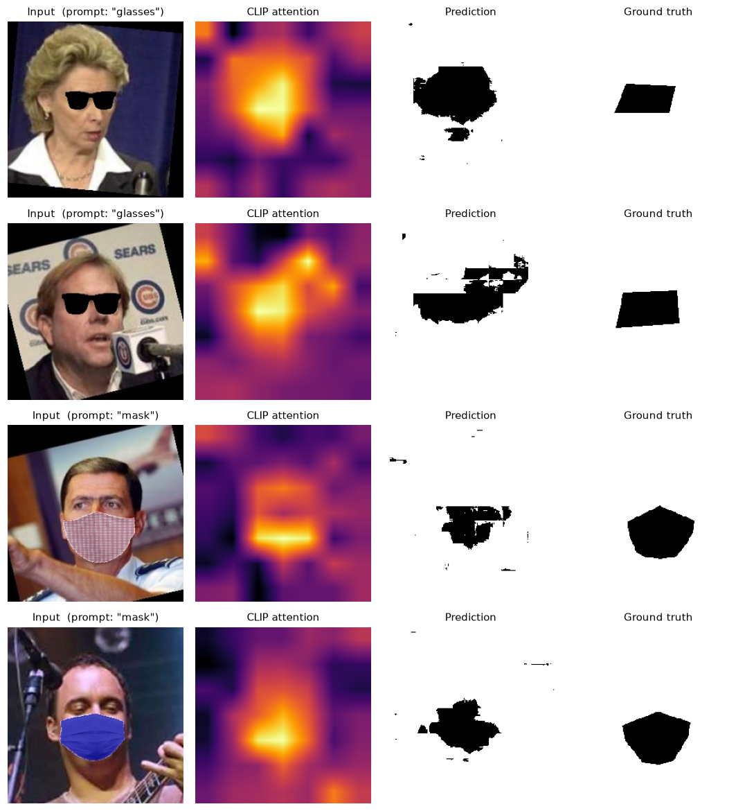
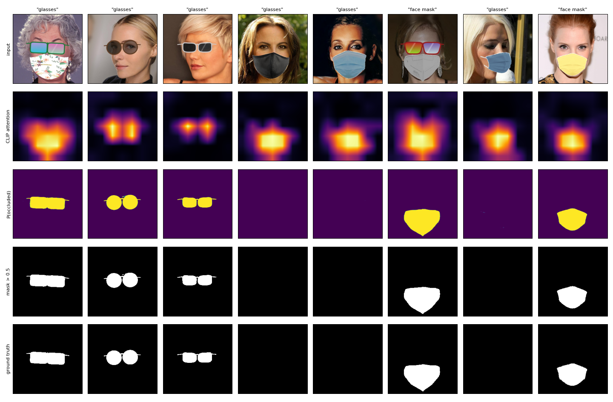
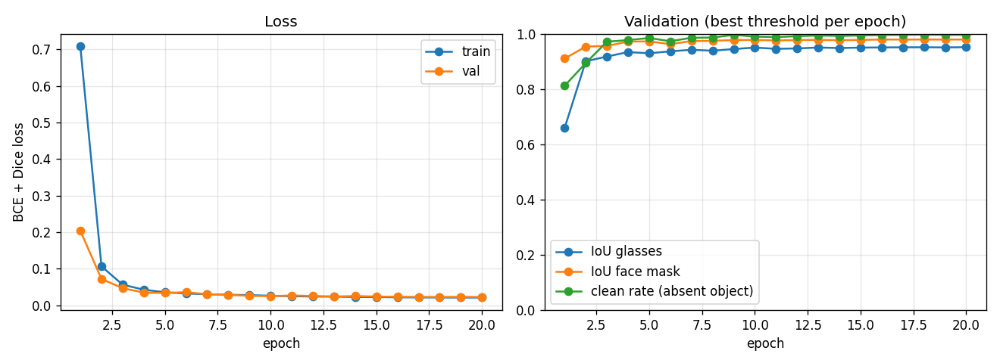
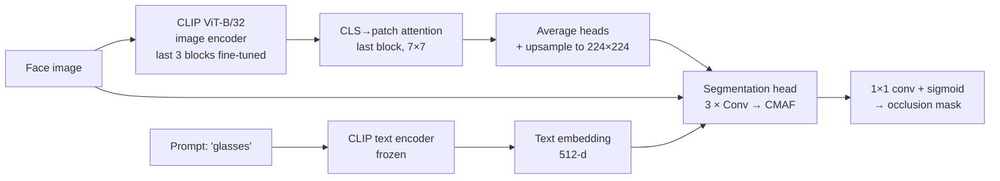

# Visus

**Text-guided segmentation of facial occlusions (glasses and face masks) using CLIP cross-modal attention.**

Give Visus a face image and a prompt such as `"glasses"` or `"mask"`, and it returns a pixel mask of the occluded region. Instead of training a segmentation network from scratch, it reuses what CLIP already knows: the CLS-token attention inside CLIP's vision transformer serves as a coarse spatial prior, and a lightweight head refines it using features from CLIP's text encoder through cross-modal attention.



## Results

**v2 (current code), trained on Kaggle (T4, 20 epochs, about 2 h).** The checkpoint and the threshold (0.6) were chosen on validation. The test split below was never seen during training or selection, and it uses 5 held-out mask textures.

| Test set | IoU glasses | IoU face mask | IoU | Clean rate | Score |
|---|---|---|---|---|---|
| Synthetic test (2,969 faces) | **0.952** | **0.979** | **0.965** | **0.997** | **0.981** |
| Empty-mask baseline | 0.000 | 0.000 | 0.000 | 1.000 | 0.000 |
| v1 checkpoint (`visus_epoch50.pt`) | 0.357 | 0.467 | 0.412 | 0.001 | 0.019 |

*IoU* is the occlusion IoU on faces where the prompted object is present. *Clean rate* is the share of empty predictions when the prompted object is absent, for example "glasses" on a mask-only face. *Score* is √(IoU × clean rate). See [Evaluation](#evaluation).

On the original project's LFW / CelebA test subsets, whose ground truth is coarse landmark polygons, v2 gets occlusion IoU 0.500 / 0.485, against 0.417 / 0.515 for v1.



<details><summary>Training curves</summary>



</details>

Raw numbers are in [`results/`](results/).

**v1 (original report)**

| Test set | mIoU | |
|---|---|---|
| CelebA (held-out) | **0.9441** | in-distribution |
| LFW | **0.9405** | out-of-distribution |

Numbers are from the [project report](docs/report/report.pdf). Ground-truth masks are generated from MediaPipe facial landmarks (see [Dataset](#dataset)).

## How it works



1. **Visual prior.** A forward hook on CLIP's last vision block recomputes its attention (on the LayerNorm-ed input, as CLIP does). The CLS token's attention over the 7×7 patch grid is averaged across heads and upsampled to image size. Gradients flow through it, so the last 3 vision blocks fine-tune.
2. **Text conditioning.** The prompt is encoded by CLIP's frozen text encoder into a 512-d embedding.
3. **Cross-Modal Attention Fusion (CMAF).** The head takes the attention map plus the RGB image. At each of three refinement stages, spatial features act as queries and the projected text embedding as key/value in multi-head attention; the result is concatenated with the vision features and fused by convolution.
4. **Training.** BCE + Dice loss, AdamW (head lr 3e-4, CLIP blocks 1e-5, weight decay 0.01), warmup + cosine schedule, mixed precision, flips/crops/rotation/colour jitter. A quarter of the training prompts name an object that is *not* in the image, with an empty target, so the model learns to follow the prompt. The checkpoint and the mask threshold are both chosen on the validation split.

This is the v2 model (current code). The v1 release `visus_epoch50.pt` used one-number-per-layer text features, an attention map without the RGB image, and no CLIP fine-tuning; `visus.checkpoint.load_model` still loads it. The original write-up is in [`docs/report/report.pdf`](docs/report/report.pdf).

## Quick start

```bash
git clone https://github.com/SreenityaThatikunta/Visus.git
cd Visus
python -m venv .venv && source .venv/bin/activate
pip install -r requirements.txt
```

Download trained weights from the [Releases](../../releases) page into `checkpoints/`, then run them on the bundled samples:

```bash
python scripts/predict.py --checkpoint checkpoints/visus_epoch50.pt --input assets/samples --output outputs/demo
```

For each image this writes `<name>_<prompt>_mask_binary.png` (occluded region in white) and a `<name>_<prompt>_viz.png` figure (input, CLIP attention, mask overlay). The prompt is read from the filename (`..._glasses.jpg`, `..._mask.jpg`); use `--prompt "sunglasses"` to set it yourself. The threshold stored in the checkpoint is used unless you pass `--threshold`. It runs on CUDA, Apple Silicon (MPS) or CPU, picked automatically.

## Training

```bash
python scripts/train.py --data data/visus_occlusion_v1 --epochs 20
```

`--data` is a folder built by the dataset generator (below): `images/`, `masks/<id>_glasses.png`, `masks/<id>_mask.png`, `meta.csv`. Output goes to `runs/default/` (change with `--output`): `checkpoints/best.pt` (best on validation) and `last.pt`, `history.json`, `training_curves.png` and sample-prediction grids. `python scripts/train.py --help` lists the options, including the ablation switches `--trainable-blocks 0` (frozen CLIP), `--text-mode attention` (v1 text features) and `--no-rgb`.

### On Kaggle

Training and dataset generation were run on free Kaggle machines with the [Kaggle CLI](https://github.com/Kaggle/kaggle-api); [`kaggle/push.sh`](kaggle/push.sh) pushes each job:

```bash
KAGGLE_USERNAME=you kaggle/push.sh generate   # build the occlusion dataset (CPU)
KAGGLE_USERNAME=you kaggle/push.sh code       # upload this repo as a private dataset
KAGGLE_USERNAME=you kaggle/push.sh train      # sanity checks, training, evaluation (GPU)
```

The training job ([`scripts/kaggle_train.py`](scripts/kaggle_train.py)) first checks that gradients reach the unfrozen CLIP blocks and that six images can be overfit, then trains and evaluates.

## Evaluation

```bash
python scripts/evaluate.py --checkpoint runs/default/checkpoints/best.pt \
    --data data/visus_occlusion_v1 --split test \
    --lfw-images data/legacy/lfw/images --lfw-gt data/legacy/lfw/gt
```

It reports, per test set, next to an "empty mask" baseline that predicts nothing:

- **IoU**: mean per-image IoU of the occluded region, for glasses and face masks, over images where the prompted object is present. An empty prediction scores 0.
- **Clean rate**: when the prompt names an object that is *not* in the image, the share of predictions that are (nearly) empty.
- **Score**: √(IoU × clean rate), which picks the checkpoint and the threshold. It is 0 both for a model that never predicts anything and for one that ignores the prompt.

`--lfw-*` / `--celeba-*` add the small LFW and CelebA test subsets from the original project (their masks mark the occlusion in black and are coarse landmark polygons).

## Dataset

There is no public dataset with pixel masks for glasses and face masks, so the training data is synthetic. [`scripts/data/kaggle_generate_occlusions.py`](scripts/data/kaggle_generate_occlusions.py) takes 30,000 face photos from CelebA-HQ and, using dlib's 68 facial landmarks:

- **face masks**: warps [MaskTheFace](https://github.com/aqeelanwar/MaskTheFace) templates (surgical, N95, KN95, cloth) with its textures and colours onto the face;
- **glasses**: draws sunglasses and glasses procedurally: round, rectangular, wayfarer, aviator and cat-eye frames with opaque, mirrored, tinted or clear lenses.

40% of faces get glasses, 40% a face mask, 20% both. Because the occlusions are pasted by the script, the labels are exact pixel masks, one per object. The split is 25,215 train / 1,484 val / 2,969 test images, and five mask textures appear only in the test split.

Datasets are not included in this repository: CelebA is licensed for non-commercial research only. The sample images in `assets/samples/` come from [LFW](https://vis-www.cs.umass.edu/lfw/) with synthetic occlusions added. The older dataset tools (`scripts/data/apply_glasses.py`, `generate_gt_masks.py`) built the v1 data.

## Repository layout

```
visus/                 the Python package
├── models/            attention + text extractors, CMAF fusion, segmentation head, full model
├── data.py            datasets (synthetic splits, legacy test sets) and augmentation
├── trainer.py         training loop, best-checkpoint selection, sample grids
├── inference.py       Predictor: checkpoint → mask for an image + prompt
├── evaluation.py      IoU / clean-rate metrics, legacy test-set matching
├── checkpoint.py      save / load (v2 and the legacy v1 release)
├── losses.py          BCE + Dice
└── config.py          defaults + device auto-detection
scripts/               train.py · predict.py · evaluate.py · kaggle_train.py · data/ (dataset tools)
kaggle/                Kaggle job configs and push.sh
docs/report/           report.pdf and its LaTeX source
docs/figures/          evaluation plots of the v1 checkpoints
assets/                README figure and sample images
```

## Authors

**Arpita Deshmukh** and **Sreenitya Thatikunta**, Indian Institute of Technology Jodhpur. Built as a Computer Vision course project, April 2026.

## Acknowledgements

[CLIP](https://github.com/openai/CLIP) (OpenAI) · [CelebA](https://mmlab.ie.cuhk.edu.hk/projects/CelebA.html) · [LFW](https://vis-www.cs.umass.edu/lfw/) · [MaskTheFace](https://github.com/aqeelanwar/MaskTheFace) · [MediaPipe](https://github.com/google-ai-edge/mediapipe) · [dlib](http://dlib.net/)

## License

Code is released under the [MIT License](LICENSE). Datasets and pretrained CLIP weights keep their own licenses.
