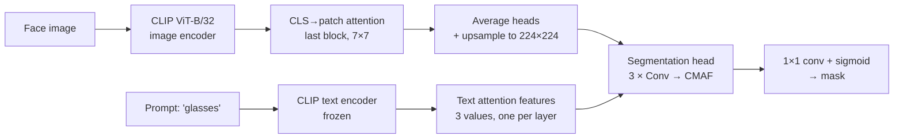
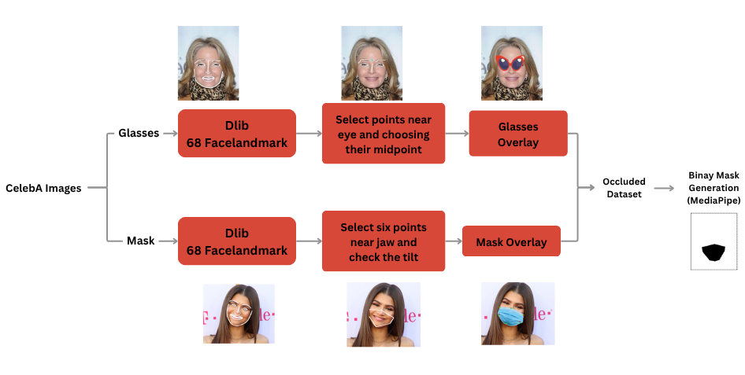

# Visus

**Text-guided segmentation of facial occlusions (glasses and face masks) using CLIP cross-modal attention.**

Give Visus a face image and a prompt such as `"glasses"` or `"mask"`, and it returns a pixel mask of the occluded region. Instead of training a segmentation network from scratch, it reuses what CLIP already knows: the CLS-token attention inside CLIP's vision transformer serves as a coarse spatial prior, and a lightweight head refines it using features from CLIP's text encoder through cross-modal attention.


## Results

| Test set | mIoU | |
|---|---|---|
| CelebA (held-out) | **0.9441** | in-distribution |
| LFW | **0.9405** | out-of-distribution |

Numbers are from the [project report](docs/report/report.pdf). Ground-truth masks are generated from MediaPipe facial landmarks (see [Dataset](#dataset)).

## How it works



1. **Visual prior.** A forward hook on CLIP's last vision block reconstructs the attention matrix. The CLS token's attention over the 7×7 patch grid is averaged across heads and upsampled to image size.
2. **Text conditioning.** Hooks on the last 3 text blocks collect CLS-to-token attention, compressed into one value per layer.
3. **Cross-Modal Attention Fusion (CMAF).** At each of three refinement stages, spatial vision features act as queries and the projected text feature as key/value in multi-head attention; the result is concatenated with the vision features and fused by convolution.
4. **Training.** Dice loss, AdamW (lr 1e-4, weight decay 0.01), batch size 24, 50 epochs. The CLIP text encoder is frozen.

The full write-up, including the synthetic dataset pipeline, is in [`docs/report/report.pdf`](docs/report/report.pdf).

## Quick start

```bash
git clone https://github.com/SreenityaThatikunta/Visus.git
cd Visus
python -m venv .venv && source .venv/bin/activate
pip install -r requirements.txt
```

Download the trained weights (`visus_epoch50.pt`, about 31 MB) from the [Releases](../../releases) page into `checkpoints/`, then run it on the bundled samples:

```bash
python scripts/predict.py --checkpoint checkpoints/visus_epoch50.pt --input assets/samples --output outputs/demo
```

For each image this writes `<name>_<prompt>_mask_binary.png` and a `<name>_<prompt>_viz.png` figure (input, CLIP attention, mask). The prompt is read from the filename (`..._glasses.jpg`, `..._mask.jpg`); use `--prompt "sunglasses"` to set it yourself. It runs on CUDA, Apple Silicon (MPS) or CPU, picked automatically, at about 5 images/s on a laptop CPU.

## Training

```bash
python scripts/train.py --images data/celeba_occluded/images --masks data/celeba_occluded/masks --epochs 50
```

Checkpoints, sample predictions and loss curves go to `runs/default/` (change with `--output`). Defaults live in [`visus/config.py`](visus/config.py); `python scripts/train.py --help` lists the overrides. The loader pairs `images/<name>.jpg` with `masks/<name>_glasses.png` or `masks/<name>_mask.png` (the names `generate_gt_masks.py` writes), and picks a random prompt from a small synonym set for each sample.

## Evaluation

```bash
# predict on a test set, then score it
python scripts/predict.py --checkpoint checkpoints/visus_epoch50.pt --input data/lfw/occluded --output outputs/lfw --no-figures
python scripts/evaluate.py --dataset lfw --pred outputs/lfw --gt data/lfw/gt

# compare every saved checkpoint (one prediction folder per checkpoint) and plot the trend
python scripts/evaluate.py --dataset celeba --pred outputs/celeba_sweep --gt data/celeba/gt --sweep --plots docs/figures
```

The ground-truth folder holds `glasses/` and `mask/` sub-folders. The script prints IoU per occlusion type, background IoU and Dice loss.

## Dataset

There is no public dataset with pixel masks for glasses and face masks, so the training data is synthetic, built from [CelebA](https://mmlab.ie.cuhk.edu.hk/projects/CelebA.html):



```bash
# 1. overlay glasses using dlib's 68-point landmarks
python scripts/data/apply_glasses.py --input data/celeba/raw --output data/celeba/occluded \
    --overlay glasses.png --predictor shape_predictor_68_face_landmarks.dat
# 2. face masks: use MaskTheFace (https://github.com/aqeelanwar/MaskTheFace)
# 3. ground-truth masks from MediaPipe Face Mesh
python scripts/data/generate_gt_masks.py --input data/celeba/occluded --output data/celeba/masks
```

Step 1 needs `pip install dlib cvzone`, a transparent PNG of glasses, and [`shape_predictor_68_face_landmarks.dat`](http://dlib.net/files/shape_predictor_68_face_landmarks.dat.bz2). Step 3 needs `pip install mediapipe`.

Datasets are not included in this repository: CelebA is licensed for non-commercial research only. The sample images in `assets/samples/` come from [LFW](https://vis-www.cs.umass.edu/lfw/) with synthetic occlusions added.

## Repository layout

```
visus/                 the Python package
├── models/            attention extractors, CMAF fusion, segmentation head, full model
├── data.py            dataset + dataloaders (seeded train/val split)
├── trainer.py         training loop, checkpointing, sample grids
├── inference.py       Predictor: checkpoint → mask for an image + prompt
├── evaluation.py      IoU / Dice metrics and ground-truth matching
├── checkpoint.py      save / load (reads the released checkpoint format)
├── losses.py          Dice loss
└── config.py          defaults + device auto-detection
scripts/               train.py · predict.py · evaluate.py · data/ (dataset tools)
docs/report/           report.pdf and its LaTeX source
docs/figures/          evaluation plots across checkpoints
assets/                README figure and sample images
```

## Authors

**Arpita Deshmukh** and **Sreenitya Thatikunta**, Indian Institute of Technology Jodhpur. Built as a Computer Vision course project, April 2026.

## Acknowledgements

[CLIP](https://github.com/openai/CLIP) (OpenAI) · [CelebA](https://mmlab.ie.cuhk.edu.hk/projects/CelebA.html) · [LFW](https://vis-www.cs.umass.edu/lfw/) · [MaskTheFace](https://github.com/aqeelanwar/MaskTheFace) · [MediaPipe](https://github.com/google-ai-edge/mediapipe) · [dlib](http://dlib.net/)

## License

Code is released under the [MIT License](LICENSE). Datasets and pretrained CLIP weights keep their own licenses.
